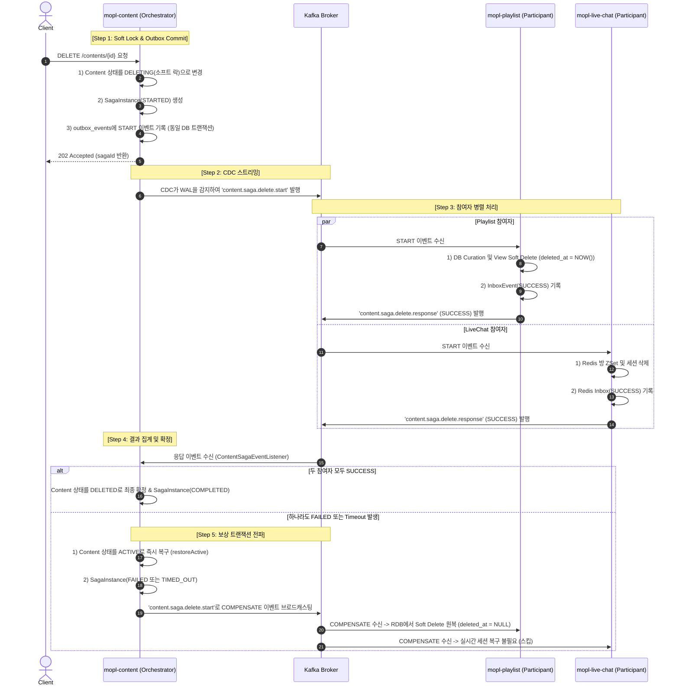

## Saga 보상 트랜잭션 구현 (CDC-Kafka)

### 1. 개요 및 아키텍처

컨텐츠 삭제 시 발생하는 분산 트랜잭션 정합성 문제를 해결하고

특히 2PC의 Locking 오버헤드와 가용성 저하를 방지하고, 이중 쓰기(Dual-Write)로 인한 데이터 불일치 문제를 해결하기 위해 

**Transactional Outbox + Debezium CDC + Kafka + Idempotent Inbox** 파이프라인을 결합하여 구축함.

#### 참여 컴포넌트
- **Orchestrator**: [`mopl-content`](file:///Users/dhk/codeit/sb06-mopl-team03/mopl-content)
  - SAGA 인스턴스 라이프사이클 관리 ([`SagaInstance`](file:///Users/dhk/codeit/sb06-mopl-team03/mopl-content/src/main/java/org/codeit/sb06/team03/mopl/entity/SagaInstance.java))
  - 트랜잭셔널 아웃박스 이벤트 적재 ([`outbox_events`](file:///Users/dhk/codeit/sb06-mopl-team03/mopl-content/src/main/java/org/codeit/sb06/team03/mopl/entity/OutboxEvent.java))
  - 응답 집계 및 보상 트리거 ([`ContentSagaEventListener`](file:///Users/dhk/codeit/sb06-mopl-team03/mopl-content/src/main/java/org/codeit/sb06/team03/mopl/event/ContentSagaEventListener.java))
  - 타임아웃 감지 스케줄러 ([`ContentSagaTimeoutScheduler`](file:///Users/dhk/codeit/sb06-mopl-team03/mopl-content/src/main/java/org/codeit/sb06/team03/mopl/scheduler/ContentSagaTimeoutScheduler.java))
- **Participants**:
  - [`mopl-playlist`](file:///Users/dhk/codeit/sb06-mopl-team03/mopl-playlist): 연관 큐레이션 및 CQRS 복제 뷰 논리 삭제(`deleted_at`), 보상 시 RDB 원자적 롤백(`deleted_at = NULL`), 7일 보관 후 새벽 Hard Purge 스케줄러, 인박스 멱등성 보장 ([`inbox_events`](file:///Users/dhk/codeit/sb06-mopl-team03/mopl-playlist/src/main/java/org/codeit/sb06/team03/mopl/entity/InboxEvent.java))
  - [`mopl-live-chat`](file:///Users/dhk/codeit/sb06-mopl-team03/mopl-live-chat): Redis 기반 시청 세션 및 채팅방 데이터 정리, Redis 인박스 멱등성 보장

### 2. 단계별 라이프사이클 및 보상 트랜잭션 흐름

### 3. 보상 트랜잭션 상세

SAGA 실패 시 이미 삭제 처리를 완료했던 참여자들의 데이터를 원상태로 되돌리기 위해 다음과 같은 보상 메커니즘을 수행함.

1. **오케스트레이터의 로컬 롤백**
   - 참여자 중 하나라도 `FAILED`를 응답하거나 타임아웃이 발생하면, 
   - [`mopl-content`](file:///Users/dhk/codeit/sb06-mopl-team03/mopl-content)는 즉시 `Content.restoreActive()`를 호출하여 컨텐츠를 다시 `ACTIVE` 상태로 전환함.
2. **플레이리스트 보상 복원 (원자적 In-Place 롤백)**
   - [`mopl-playlist`](file:///Users/dhk/codeit/sb06-mopl-team03/mopl-playlist)는 외부 캐시 백업 의존성을 배제하고, RDB 내부에서 `deleted_at` 타임스탬프를 활용한 **Soft Delete**를 수행함.
   - `COMPENSATE` 액션 수신 시, 단일 `UPDATE` 쿼리로 `deleted_at = NULL` 원복을 수행하여 데이터 유실 없는 완벽한 ACID 롤백을 보장함.
   - 소프트 삭제된 튜플은 [`PlaylistPurgeScheduler`](file:///Users/dhk/codeit/sb06-mopl-team03/mopl-playlist/src/main/java/org/codeit/sb06/team03/mopl/scheduler/PlaylistPurgeScheduler.java)가 매일 새벽 4시에 7일 경과 데이터를 물리 삭제(Hard Purge)하여 테이블 비대화를 방지함.
3. **워칭세션 보상**
   - 실시간 시청 세션은 이미 연결이 끊어지거나 종료된 휘발적 성격이 강하므로, 세션을 인위적으로 재생성하지 않고 안전하게 스킵 처리함.

### 4. 엣지 케이스 대응

#### 1) 참여자 무응답 / 프로세스 정지 (Hang)
- **위험**: 참여자 서버 다운 또는 네트워크 지연으로 응답이 영원히 오지 않아 컨텐츠가 `DELETING` 상태에 갇힘
- **대응**:
  - [`ContentSagaTimeoutScheduler`](file:///Users/dhk/codeit/sb06-mopl-team03/mopl-content/src/main/java/org/codeit/sb06/team03/mopl/scheduler/ContentSagaTimeoutScheduler.java)가 **1분 주기**로 스케줄링 실행
  - 생성된 지 **3분(`TIMEOUT_DURATION`)**이 지난 `STARTED` 상태의 SAGA 인스턴스를 자동 감지
  - 상태를 `TIMED_OUT`으로 전환하고 컨텐츠를 `ACTIVE`로 자동 복구한 뒤, 보상(`COMPENSATE`) 이벤트를 강제 브로드캐스팅

#### 2) 메시지 중복 수신 (At-Least-Once Delivery)
- **위험**: 네트워크 재전송이나 Consumer Rebalance로 인해 동일한 SAGA 이벤트가 중복 수신되어 불필요한 삭제나 중복 응답 발생
- **대응**:
  - **Transactional Inbox 패턴**  적용
  - `mopl-content`: `messageId = saga-resp-{sagaId}-{participant}-{status}` 기반 중복 처리 차단
  - `mopl-playlist`: `inbox_events` 테이블 조회 후, 이미 처리된 건은 추가 비즈니스 로직 없이 기존 성공/실패 응답을 멱등하게 재회신
  - `mopl-live-chat`: Redis의 `inbox:saga-start:{sagaId}:watching-session` 키로 멱등 처리

#### 3) 지연 응답 도착 (Late Arrival Response)
- **위험**: 타임아웃으로 이미 SAGA가 실패/롤백 처리되어 컨텐츠가 `ACTIVE`로 복원되었는데, 뒤늦게 지연되었던 참여자의 `SUCCESS` 응답이 도착하여 컨텐츠가 삭제되는 역전 현상
- **대응**:
  - [`ContentSagaEventListener`](file:///Users/dhk/codeit/sb06-mopl-team03/mopl-content/src/main/java/org/codeit/sb06/team03/mopl/event/ContentSagaEventListener.java)에서 `sagaInstance.isFinished()` 검증
  - 이미 `COMPLETED`, `FAILED`, `TIMED_OUT`으로 종료된 SAGA의 응답은 폐기하여 상태 오염 차단

#### 4) 메시지 역직렬화 실패 (Poison Pill)
- **위험**: 페이로드 JSON 파싱 에러 발생 시 Kafka Consumer가 무한 재시도 루프에 빠져 파티션 컨슘이 블로킹됨
- **대응**:
  - `handleDeserializationFailure()` 에러 핸들러 구성
  - JSON 파싱에 실패하더라도 정규식(Regex)을 이용해 페이로드 문자열에서 `sagaId`와 `contentId`를 추출
  - 오케스트레이터로 즉시 `FAILED(DESERIALIZATION_FAILURE)` 응답을 회신하여, 타임아웃까지 기다리지 않고 즉각적인 보상 트랜잭션을 발동시킴

#### 5) 서버 크래시 및 비정상 종료 (Atomicity)
- **위험**: 비즈니스 로직 DB 커밋 후 카프카 전송 전 서버가 다운되어 분산 트랜잭션이 유실되는 이중 쓰기(Dual-Write) 문제
- **대응**:
  - **트랜잭셔널 아웃박스 패턴 ([`outbox_events`](file:///Users/dhk/codeit/sb06-mopl-team03/mopl-content/src/main/java/org/codeit/sb06/team03/mopl/entity/OutboxEvent.java))**
  - 비즈니스 상태 변경(`DELETING`)과 Outbox 이벤트 저장이 **동일한 RDB 트랜잭션**으로 원자적 커밋되므로 메시지 누락 가능성 0% 보장

#### 6) 롤백 시 원본 데이터 소실 (Lost Data on Rollback)
- **위험**: 물리 삭제(Hard Delete)를 먼저 수행할 경우 보상 트랜잭션 시 이미 삭제된 데이터를 알 수 없어 복구 불가 및 데이터 영구 소실 위험 발생
- **대응**:
  - `mopl-playlist`에서 물리 삭제 대신 `deleted_at = NOW()` 타임스탬프를 기록하는 **Soft Delete**를 수행
  - 보상 트랜잭션(`COMPENSATE`) 수신 시 `deleted_at = NULL`로 즉시 원복하므로, 외부 캐시/네트워크 장애 위험 없이 100% 무손실 롤백을 보장함
  - 최종 정리되지 않은 소프트 삭제 데이터는 7일 보관 후 새벽 스케줄러가 일괄 물리 삭제(Hard Purge)하여 성능과 정합성을 모두 달성함
